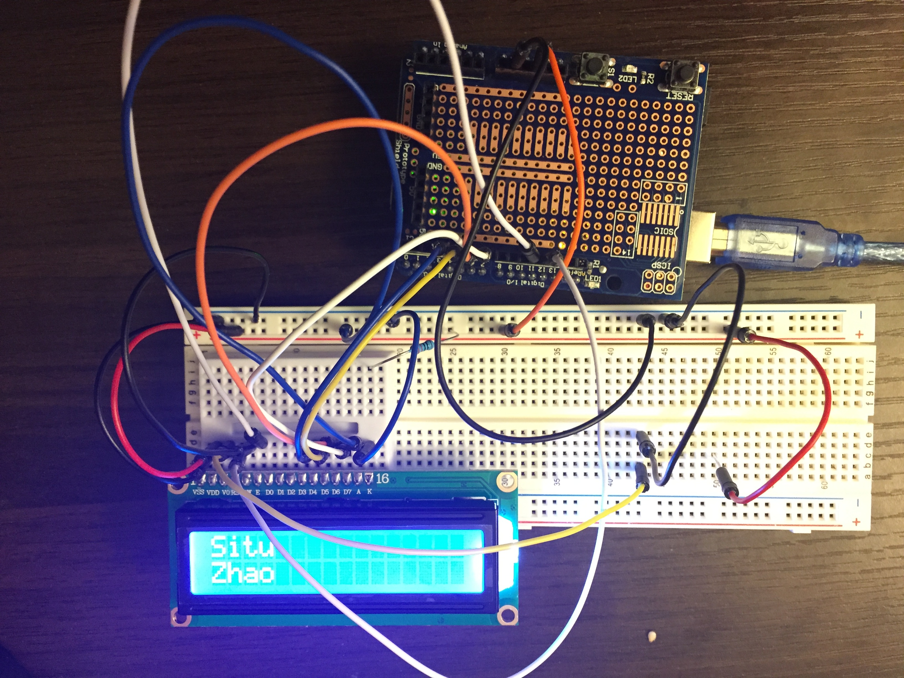

# Arduino Two-Row LCD Name Display

A small embedded-systems project: an **Arduino-compatible board** drives a
**two-row display LCD** to show a name across its two rows.



## What it does

The board initializes the LCD and prints text on the two rows:

```
Situ
Zhao
```


## Hardware

- An **Arduino-compatible board** (with a prototyping shield, in the photo)
- A **two-row display LCD**
- A breadboard and jumper wires
- USB cable for power and programming

## Author

Situ Zhao
